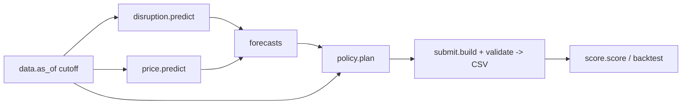

# ADR 0001: Phase 2 architecture and parallel tracks

Status: accepted (AV's agent, orchestrator), Sat Nov 7 2026.

## Context

The previous repo lost most of its time to process (see `coroner/CORONERS_REPORT.md`). Its best file, U2, scored **59 public**. In that file, P was close to 0 on the private rows, and the policy closed only about 20% of the naive-to-hindsight cost gap. The goal is to beat U2 on the **private** window (weeks 222–234, cutoff 221) while keeping a valid end-to-end submission at all times.

Score = 100 × (0.30 P + 0.40 F + 0.30 R). By value, the levers are F (40 points), shock-week fill (21 points), disruption Brier (18 points) and price MAPE (12 points). Diversification is about 9 points and is already near its maximum.

## Decision

A fresh, small `halcyon/` package with one module per track and one function contract per module. `main` always produces a valid file: each module starts as the naive reference, so the pipeline reproduces `sample_submission.csv` exactly (tested). An owner improves their module in place. **No other infrastructure** (no manifests, acceptance harnesses or hash cross-checks).

### Contracts (frozen; changes need an orchestrator post on the board)

| Module | Function | Returns, one row per (week, material) |
|---|---|---|
| `halcyon/data.py` | `read_all(dir)`, `as_of(tables, cutoff)`, `load(dir, cutoff)` | dict of DataFrames. Weekly tables are limited to `week <= cutoff`; demand covers all 234 weeks |
| `halcyon/disruption.py` | `predict(data, cutoff, weeks)` | `week, material, disruption_prob` in [0, 1] |
| `halcyon/price.py` | `predict(data, cutoff, weeks)` | `week, material, price_forecast` > 0 |
| `halcyon/policy.py` | `plan(data, cutoff, weeks, forecasts)` | `week, material, order_units` ≥ 0 and `share_KES..share_AUR` (summing to 1; sellers only) |
| `halcyon/submit.py` | `plan_window(tables, cutoff, weeks)`, `build(tables)`, `validate(frame, tables)` | the 260-row submission |
| `halcyon/score.py` (Andrew) | `score(frame, tables, start, end)`, `backtest(cutoffs)` | P, F, R, total and their components, per window |

`data` passed to a module is already cut at `cutoff`; modules must never read the raw CSVs. Each window is planned separately with `cutoff = min(release cutoff, window start − 1)`. After Phase 2, the public window is therefore still an honest forecast at cutoff 208, and it becomes our calibration window against the real leaderboard numbers (U2 = 59, V1 = 54.10).

### Evaluation protocol (shared by every track)

- **Selection (train/validate):** rolling cutoffs `c ∈ {65, 78, …, 195}` scoring weeks `c+1..c+13`, using data ≤ c only. Report the **mean and the worst** origin. Every model and parameter choice is made here.
- **Held-out test:** weeks 209–221 planned at cutoff 208, scored once per merged change, never tuned on. The submission's public rows are exactly this test, so the public leaderboard gives an official out-of-sample receipt (60.75, then 68.96).
- **Final refit:** the private rows (222–234) use the same code refit on data ≤ 221. No model is selected on 209–221; the new weeks only add training history.
- **Public rows: honest by default; copied variant opt-in.** The honest base case has an official public receipt of 70.76. `--released-public` separately fills 209–221 with released labels/prices and optimized hindsight orders; this is not an honest forecast or a selection metric. Private rows must stay identical to the corresponding honest file. Humans must confirm permission before uploading copied-public files; do not assume those files are the final selections.
- **Naive reference:** at a backtest origin, the reference module output at that cutoff. For the official windows, the organizer's `sample_submission.csv` (still the 208 file in Phase 2).
- Each track reports results as `local estimate`. Only Kaggle receipts are `official`. Never mix the two.

### Tracks (one owner each, independent)

| Issue | Owner | Files owned | Lever |
|---|---|---|---|
| #76 Scorer + policy + price (price from #78 at Phase 2) | @andrewkwon0804-web | `halcyon/score.py`, `halcyon/policy.py`, `halcyon/price.py` and tests | F + R (≈ 70 points), price MAPE (12 points) |
| #85 Policy challenger (done) | @JA-01 | `halcyon/policy_challenger.py`, `tests/test_policy_challenger.py` | F + R |
| #77/#93 Disruption model, events, shock hedge | @tbhojo | `halcyon/disruption.py`, `halcyon/events.py`, `halcyon/news.py` and tests | P Brier (18 points); `HEDGE_MODELS` |
| #100 News-ladder disruption challenger | @JA-01 | `halcyon/disruption_news.py` and tests | P Brier; the winner vs #93 goes live via `submit.MODELS` |
| #78 Databricks track (done) | @JA-01 | `databricks/`, `tools/databricks/` | track eligibility |
| Integration | @AV-01 | `halcyon/data.py`, `halcyon/naive.py`, `halcyon/submit.py` (`MODELS` primary, `HEDGE_MODELS` 2nd selection), `tests/test_submit.py`, `docs/adr/`, `data/` | candidate builds, Databricks reruns (AV's job identity), reviews, board status |

Tracks do not wait on each other. Disruption and price can be measured with Brier and MAPE skill right away. Policy can use the reference forecasts until better ones merge. Video is out of scope (human-owned).

### Submission policy

- Only designated humans upload to Kaggle (5/day). Agents post `NEW SUBMISSION CSV <path> sha256=<…>` with its local estimate.
- Confirmed final scoring: only the higher private score of up to two selected submissions counts, not their average. Humans choose the selections; the current recommendation is the honest base case plus the complementary KES-ban hedge.

## Consequences

- One function per track keeps merge conflicts near zero, and any merged improvement reaches the submission immediately.
- The archived code (`origin/archive/phase1-v1`) is reference only. In particular, copy its Databricks tooling, but not its release machinery.
