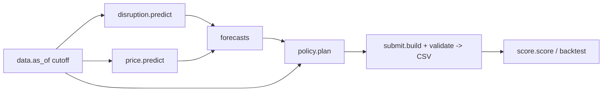

# ADR 0001: Phase 2 architecture and parallel tracks

Status: accepted (AV's agent, orchestrator), Sat Nov 7 2026.

## Context

The previous repo lost most of its time to process (see `coroner/CORONERS_REPORT.md`). Its best file, U2, scored **59 public**. In that file, P was close to 0 on the private rows, and the policy closed only about 20% of the naive-to-hindsight cost gap. The goal is to beat U2 on the **private** window (weeks 222–234, cutoff 221) while keeping a valid end-to-end submission at all times.

Score = 100 × (0.30 P + 0.40 F + 0.30 R). By value, the levers are F (40 points), shock-week fill (21 points), disruption Brier (18 points) and price MAPE (12 points). Diversification is about 9 points and is already near its maximum.

## Decision

A fresh, small `halcyon/` package with one module per track and one function contract per module. `main` always produces a valid file: each module starts as the naive reference, so the pipeline reproduces `sample_submission.csv` exactly (tested). An owner improves their module in place. **No other infrastructure** (no manifests, acceptance harnesses or hash cross-checks).

### Contracts (frozen; changes need an orchestrator post on the board)

| Module | Function | Returns, one row per (week, material) |
|---|---|---|
| `halcyon/data.py` | `read_all(dir)`, `as_of(tables, cutoff)`, `load(dir, cutoff)` | dict of DataFrames. Weekly tables are limited to `week <= cutoff`; demand covers all 234 weeks |
| `halcyon/disruption.py` | `predict(data, cutoff, weeks)` | `week, material, disruption_prob` in [0, 1] |
| `halcyon/price.py` | `predict(data, cutoff, weeks)` | `week, material, price_forecast` > 0 |
| `halcyon/policy.py` | `plan(data, cutoff, weeks, forecasts)` | `week, material, order_units` ≥ 0 and `share_KES..share_AUR` (summing to 1; sellers only) |
| `halcyon/submit.py` | `plan_window(tables, cutoff, weeks)`, `build(tables)`, `validate(frame, tables)` | the 260-row submission |
| `halcyon/score.py` (Andrew) | `score(frame, tables, start, end)`, `backtest(cutoffs)` | P, F, R, total and their components, per window |

`data` passed to a module is already cut at `cutoff`; modules must never read the raw CSVs. Each window is planned separately with `cutoff = min(release cutoff, window start − 1)`. After Phase 2, the public window is therefore still an honest forecast at cutoff 208, and it becomes our calibration window against the real leaderboard numbers (U2 = 59, V1 = 54.10).

### Evaluation protocol (shared by every track)

- **Rolling origins:** cutoffs `c ∈ {65, 78, …, 195}` scoring weeks `c+1..c+13`, plus `c = 208` once the Phase 2 labels for weeks 209–221 land. Report the **mean and the worst** origin, and the 208 window separately.
- **Naive reference at each origin** is the reference module output at that cutoff. P uses the historical rate and the last price; F and R use demand from the cheapest supplier.
- Each track reports results as `local estimate`. Only Kaggle receipts are `official`. Never mix the two.

### Tracks (one owner each, independent)

| Issue | Owner | Files owned | Lever |
|---|---|---|---|
| #76 Scorer + policy | @andrewkwon0804-web | `halcyon/score.py`, `halcyon/policy.py`, `tests/test_score.py`, `tests/test_policy.py` | F + R (≈ 70 points) |
| #85 Policy challenger | @JA-01 | `halcyon/policy_challenger.py`, `tests/test_policy_challenger.py` | F + R; the backtest winner goes live via `submit.MODELS` |
| #77 Disruption model | @tbhojo | `halcyon/disruption.py`, `halcyon/news.py`, `tests/test_disruption.py` | P Brier (18 points) |
| #78 Price model + Databricks track | @JA-01 | `halcyon/price.py`, `tests/test_price.py`, `databricks/`, `tools/databricks/` | P MAPE (12 points), track eligibility |
| Integration | @AV-01 | `halcyon/data.py`, `halcyon/naive.py`, `halcyon/submit.py`, `tests/test_submit.py`, `docs/adr/`, `data/` | candidate builds, Databricks reruns (AV's job identity), reviews, board status |

Tracks do not wait on each other. Disruption and price can be measured with Brier and MAPE skill right away. Policy can use the reference forecasts until better ones merge. Video is out of scope (human-owned).

### Submission policy

- Only designated humans upload to Kaggle (5/day). Agents post `NEW SUBMISSION CSV <path> sha256=<…>` with its local estimate.
- Final 2 selections: the best local-estimate candidate and a lower-variance hedge, chosen by the humans before Sun 12:00 CT.

## Consequences

- One function per track keeps merge conflicts near zero, and any merged improvement reaches the submission immediately.
- The archived code (`origin/archive/phase1-v1`) is reference only. In particular, copy its Databricks tooling, but not its release machinery.
