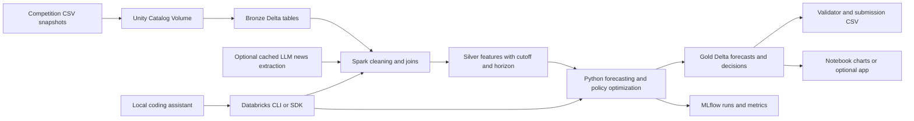

# Supply Chain Disruptor — Databricks-track requirements

Date: November 6, 2026. Team: Bay Area Builders. Status: implementation requirements. Workspace provisioning, CSV ingestion, Spark joins, and an MLflow setup check are implemented in [tools/databricks](../tools/databricks/README.md); forecasting and policy evaluation remain to be built.

This is a fresh specification based on the competition instructions, supplied data, and the decision to enter the Databricks track. The generated root `requirements.md` was deliberately excluded from the review. See [LLM integration research](databricks-llm-integration.md) for ways to build and operate the workspace without computer control.

Execution authority: [implementation plan](implementation-plan.md),
[shared contracts](contracts.md), and [agent handoffs](agents/README.md).
Andrew owns integration/export/release; Tejas owns forecasts; AV owns
simulation/policy; Jaseer retains setup support and human review. Target APIs
and commands in those documents are not implemented yet.

## 1. Goal and scope

Build a reproducible supply-chain decision pipeline that forecasts disruption probabilities and benchmark prices, converts forecasts into weekly orders and supplier allocations, and exports a valid Kaggle submission. Demonstrate meaningful Databricks use through persistent Delta tables, Spark transformations, and MLflow experiment comparisons.

The competition requires a pipeline built in Databricks Free Edition; the repo does not contain a detailed sponsor judging rubric. Delta, Spark, and MLflow are our chosen implementation commitments, not a claim that the organizers mandate all three. Models, optimization, LLM calls, and an optional frontend can use ordinary Python or run outside Databricks when practical.

The minimum demo is an executed Databricks notebook showing data → features → forecasts → ordering policy → evaluated submission. A chatbot or a hosted application is optional.

## 2. Sources and current repository state

Use these local sources in this order when they conflict:

1. [Competition instructions](../kaggle_instructions.md): scoring, simulator, release windows, CSV contract.
2. [Participant cheat sheet](<../Participant Cheat Sheet (share with teams).md>): deadlines, submission limits, final selection, video.
3. [Organizer emails](../emails.md): track description and team video delivery. The early email's “300+ products” description is superseded by the competition's 10 materials.
4. Actual [CSV files](../data/): current schemas and released coverage.

At the initial repository review, the README and board scripts were a team coordination template, with no training modules, simulator, dependency manifest, notebooks, or application to migrate. The subsequent [Databricks setup](databricks-setup-status.md) adds the initial workspace/data bootstrap and pinned setup dependencies. Assigned implementation owners and exact paths are now recorded in `AGENTS.md`.

Measured from the checked-in files:

| Input | Rows | Grain / available weeks |
| --- | ---: | --- |
| `news.csv` | 4,317 | Article; weeks 1–208 |
| `prices.csv` | 6,240 | Week × material × supplier country; 1–208 |
| `tariffs.csv` | 6,240 | Week × material × supplier country; 1–208 |
| `shipping.csv` | 1,040 | Week × lane; 1–208 |
| `macro.csv` | 1,248 | Week × country; 1–208 |
| `suppliers.csv` | 30 | Material × country; static |
| `demand.csv` | 2,340 | Week × material; **1–234**, including future demand |
| `outcomes.csv` | 2,080 | Week × material; labels for 1–208 |
| `supply_history.csv` | 6,240 | Week × material × country; realized supply for 1–208 |
| `sample_submission.csv` | 260 | Target IDs for weeks 209–234 |

There are 10 materials, 6 countries, 5 lanes, and exactly 3 eligible countries per material. News contains 231 unique headlines and 265 unique bodies. Cache extraction by the full input content and prompt/model version; a headline alone is not a sufficient key. Preserve every article's week and date even when text repeats.

## 3. Delivery priorities

| Priority | Requirement | Acceptance evidence |
| --- | --- | --- |
| P0 | Ingest competition data into Delta tables in Free Edition | Row counts, keys, release identifier, and table history visible in the workspace |
| P0 | Build typed, temporally valid features with Spark SQL/DataFrames | Executed feature notebook and cutoff checks |
| P0 | Produce baseline and candidate disruption/price forecasts | Held-out Brier and MAPE comparison by horizon |
| P0 | Convert forecasts into feasible order quantities and shares | Independent public/private inventory simulations and policy comparison |
| P0 | Track baseline and candidate runs with MLflow | Workspace experiment with parameters, metrics, artifacts, and data/code provenance |
| P0 | Validate and export a 260-row CSV | Validator passes the exact exported file; run ID identifies its provenance |
| P0 | Operate the pipeline programmatically | CLI/SDK job run, status, metrics, and artifact retrieval after initial authentication |
| P0 | Submit track opt-in, final CSV selections, and methodology video | Human checklist completed by organizer deadlines |
| P1 | Extract structured news events with an LLM | Cached outputs, article evidence, evaluation sample, and features-with/without-news comparison |
| P1 | Present a material/week risk and policy view | Charts or simple Streamlit interface backed by actual run outputs |
| P2 | Add MCP analytics, MLflow LLM tracing, or model registration | Working optional feature that does not delay the submission path |

P0 is the release gate. An LLM-powered product is useful only if it improves results or explains them; a development assistant can still write and run the entire P0 pipeline through Databricks APIs.

## 4. Architecture and Databricks responsibilities



- **Databricks:** source snapshots in a Volume, managed Delta tables, Spark ingestion/feature joins, an executable notebook or job, workspace MLflow tracking, and persisted forecast/policy outputs.
- **Flexible Python execution:** pandas/scikit-learn, optionally CatBoost, and SciPy optimization. Prefer running the small model and policy stages inside the notebook initially. Local experimentation is acceptable, but the demonstrated pipeline must actually consume and produce Databricks data.
- **Optional local components:** frontend, external-provider LLM extraction, and development assistant. Persist extracted news back to Delta so it is reproducible.

Delta supports Spark access, schema enforcement, and versioned table history; these give us auditable reruns rather than a cosmetic data upload. See [Delta Lake documentation](https://docs.databricks.com/aws/en/delta/).

Use a configurable existing catalog and a team schema, for example `<catalog>.halcyon`. Do not assume permission to create a catalog. Proposed tables within that schema:

| Table(s) | Contract |
| --- | --- |
| `bronze_<source>` for the 9 source CSVs, plus `bronze_sample_submission` | Original fields plus `release_id`, `ingested_at`, and source checksum; retain release snapshots |
| `silver_supplier_week` | Unique `(release_id, week, material, country)`; typed joins to supplier, lane, tariff, market, and macro data |
| `silver_news_events` (P1) | Article ID/week, content hash, entities, event type, certainty, effective timing, evidence, prompt/model version |
| `silver_features` | Run/release/window/feature-version context plus `(cutoff_week, target_week, material)`; cutoff is the example's historical origin |
| `gold_forecasts` | `(run_id, window_id, target_week, material)`, release, disruption probability, price prediction, model and cutoff identifiers |
| `gold_decisions` | Same key, order quantity, six country shares, policy version, explanation/evidence references |
| `gold_backtests` | Run/fold/material metrics, cost decomposition, stockouts, fill rate, and diversification |

Rerunning a release must not duplicate natural keys. Join country-level inputs at supplier grain, aggregate to material grain, then join labels; never accidentally multiply material rows by three. Store historical realized capacity, lead time, landed cost, and outcomes separately from prediction features unless their availability is explicitly bounded by the cutoff.

## 5. Functional requirements

### FR-1: Ingestion and data quality

Read CSVs using explicit schemas, with blank tariff announcements treated as null. Check uniqueness, required values, material/country/lane membership, 3 suppliers per material, and expected week coverage. Validate nonnegative demand/capacity/cost and positive lead times. Fail with the offending table/key when data violates the contract.

Keep Phase 1 and Phase 2 inputs distinguishable using release IDs and checksums. A Phase 2 rerun must detect coverage through week 221, rebuild affected features, retrain, and produce a new artifact without manual feature edits. Future demand is intentionally available; other future inputs must not be invented or forward-filled from later releases into earlier backtests.

### FR-2: Point-in-time feature generation

Every prediction records `cutoff_week`, `target_week`, and `horizon = target_week - cutoff_week`. At a historical origin C, features may use observations released by C, known future demand, and announcements already visible by C. Labels used to fit models must also be available by C.

Candidate features include historical disruption rates; trailing spot-price changes/volatility; futures-to-spot spreads; tariff levels and already-announced changes; lagged capacity and lead-time deterioration; lane congestion/transit changes; macro trends; and optional news event counts/decay. Future realized `landed_cost`, `capacity_units`, `lead_time_weeks`, `benchmark_price`, and `disrupted` are evaluation data, not future covariates.

Build multi-step predictions from the fixed release cutoff. A direct horizon-conditioned model or a recursively forecast feature path is acceptable; reading actual intermediate test weeks is not. Treat `futures_4w` as a quote observed at its source week, not as a realized future price.

### FR-3: Forecasting

Implement material historical-disruption-rate and last-known-benchmark-price baselines. Compare with a pooled tabular classifier/regressor using material identity, lagged signals, and horizon. Start with scikit-learn; evaluate CatBoost if package/runtime support is straightforward. No GPU, distributed model training, or neural time-series system is required for 2,080 labeled material-weeks.

Output finite probabilities in `[0, 1]` and strictly positive prices. Evaluate probability calibration and performance across horizons and materials. Keep baseline fallback behavior for missing features or failed optional news extraction. Select candidates by repeatable validation, not model complexity.

### FR-4: News intelligence (P1)

Use only provided synthetic news. Extract countries/lanes/materials, shock category, warning versus active event, rumor/confirmation, announced timing, and a short supporting evidence span into a schema-validated record. Resolve fictional names using `suppliers.csv` and the competition country/lane mapping. Do not supplement the world with real news or assumed real-world geopolitics.

Separate textual extraction from temporal interpretation: repeated text can reuse extraction, but each article's availability and relative dates must be evaluated at its own timestamp. Join lane disruptions to every affected supplier, including both KES and SUN for MERROW. Cache successful outputs, bound retries, and record unknown entities or malformed output. Compare the same forecast/policy setup with and without news features before claiming an improvement.

### FR-5: Ordering policy and simulator

Implement the documented simulator locally so policy changes can be compared. Orders split by six shares; each supplier fills up to that week's capacity, cancels unfilled quantity without charging, charges realized landed cost on filled quantity, and delivers after realized lead time. Process arrivals, satisfy demand, record stockouts, holding expense, and terminal salvage.

Use 2% weekly holding cost, 5× unmet-demand penalty, and 70% terminal salvage for stock and in-transit units, based on the organizer-defined average landed cost. Each public/private window starts separately with five weeks of demand in stock and zero in transit. **Never carry public-window inventory into week 222.**

Compare the sample policy against an inventory-cover heuristic with diversified eligible suppliers. Improve through capacity/lead-time forecasts and a bounded SciPy optimization or scenario policy only after this baseline works. Account for common-lane shocks: multiple country suppliers do not necessarily provide independent shipping risk. Terminal salvage and arrivals beyond the horizon must affect ordering.

The repo does not fully specify the average-landed-cost reference, how five weeks of varying demand becomes initial units, integer rounding/timing edge cases, or the hindsight optimization. Isolate these as documented simulator assumptions, seek the starter simulator/organizer clarification, and show sensitivity. Do not present the local simulator as an exact replica before parity is established.

### FR-6: Backtesting and score reporting

Use expanding-window, fixed-origin backtests, such as origins 130, 156, and 182 with following 26-week horizons. Fit/tune only on information available at each origin; the last fold must remain untouched until candidate selection is complete. Also report the two 13-week subwindows with fresh inventory initialization to mirror competition scoring. Avoid random row splits and evaluate all materials in each fold.

Development origins are 130/156; final holdout is 182. Both Phase 1-style
subwindows use the same origin C; do not reveal the first 13 weeks before
forecasting the second. Report horizon 1–13 separately for Phase 2. Recompute
historical naive forecasts/policies from each origin's history and known demand:
week-208 sample values are unavailable at earlier origins. Keep local naive
policy metrics distinct from official sample scoring until organizer parity.

Competition score: `100 × (0.30P + 0.40F + 0.30R)`, with components clipped to `[0, 1]`:

- `P`: 60% Brier skill relative to historical material disruption rates and 40% MAPE skill relative to last known price.
- `F`: `(naive cost - policy cost) / (naive cost - hindsight cost)`.
- `R`: 70% shock/recovery-week fill-rate skill and 30% normalized supplier diversification. Shock periods include four recovery weeks; the normalized 3-supplier diversification is `(1 - sum(shares²)) / (1 - 1/3)` per eligible allocation, subject to organizer aggregation rules.

Log raw Brier/MAPE, total and decomposed costs, overall/shock fill rates, and allocation concentration. Document weighting, degenerate denominators, and any unresolved normalization. If hindsight cost or exact aggregation is unavailable, report proxy financial/resilience metrics and raw costs explicitly; do not manufacture an “official” total score.

A candidate should improve prediction metrics and/or policy outcomes across multiple folds, with visible tradeoffs. No leaderboard improvement or target score can be guaranteed in the requirements.

### FR-7: MLflow reproducibility

Log at least the naive baseline and one candidate to a workspace experiment. Each run records Git commit, release/checksums, Delta table versions, cutoff/folds, seed, feature/model/policy configuration, package versions, metrics, predictions, validation report, and submission artifact. Use explicit logging where autologging does not cover the policy. Models may train on pandas arrays while Spark builds features; MLflow does not require Spark ML models. See [Databricks MLflow tracking](https://docs.databricks.com/aws/en/mlflow/tracking).

### FR-8: Submission contract

Export exactly these columns, in this order:

```text
id,disruption_prob,price_forecast,order_units,share_KES,share_VAL,share_SUN,share_ORI,share_HAL,share_AUR
```

The exact ID set must equal `sample_submission.csv`: 260 unique IDs, 10 materials × weeks 209–234. Reject missing/extra/duplicate IDs, blank/non-finite values, out-of-range probabilities or shares, nonpositive prices, negative orders, ineligible-country shares, and share totals outside a documented small numeric tolerance (proposed `1e-6`). Shares still sum to 1 when `order_units` is zero.

Produce one real CSV file with a header and no DataFrame index, not a Spark output directory containing part files. Re-read and validate the exported bytes. Store its checksum and run ID alongside the file; keep metadata out of the competition CSV.

Phase 1: predict all 209–234 using cutoff 208. Phase 2: train through 221 and forecast private weeks 222–234; still emit all 260 IDs. Released public rows can use now-known outcomes, but label them retrospective and do not count them as out-of-sample evidence. Any simulated public/private policies use independent initial inventory.

The default Phase 2 integration retains the validated Phase 1 public rows and
their original run/cutoff/checksum, then generates fresh private rows. Rerunning
or retrospectively optimizing the public block is optional; it never carries
public inventory into private or becomes new validation evidence.

### FR-9: Demonstration

Show an actual Delta table/history, a Spark feature transformation, an MLflow baseline/candidate comparison, one news or market signal traced to a forecast and supplier decision, and the validated CSV. Describe one limitation, such as unannounced policy reversals or correlated lane risk. Cached charts/artifacts should keep the presentation usable if compute is unavailable; identify them as recorded results.

## 6. Runtime and operational requirements

Free Edition uses serverless compute, a limited SQL warehouse, restricted outbound internet, and fair-use quotas that can suspend compute. Use short batch jobs, small models, cached extraction, and exported results. Feature/model/LLM endpoint availability must be checked in the actual workspace; do not base P0 on a particular hosted LLM or MCP preview. See [Free Edition limitations](https://docs.databricks.com/aws/en/getting-started/free-edition-limitations).

Use Python, Spark DataFrames/SQL, Unity Catalog Volumes, and workspace files. Avoid RDD/SparkContext dependencies, DBFS-root storage, cluster creation, and internet calls inside Spark UDFs on this serverless path. Pin the tested Python environment and validate imports before model work. See [serverless limitations](https://docs.databricks.com/aws/en/compute/serverless/limitations).

The CLI/SDK must run ingestion/notebooks/jobs, inspect status, and retrieve results after initial user sign-in. Keep credentials outside Git. Scope operations to the team's schema and workspace paths, bound retries/timeouts, and retain a known-good CSV. Detailed integration options and smoke checks are in [the companion research](databricks-llm-integration.md).

## 7. Implementation sequence and final checklist

1. **Access and working baseline:** opt into the track; authenticate CLI; verify table/Volume/MLflow access; upload a tiny CSV; execute one Spark write/read and one MLflow run. Export a baseline submission immediately.
2. **Data and evaluation:** ingest all sources, enforce keys and cutoffs, implement simulator assumptions, and establish fixed-origin baseline metrics.
3. **Forecasts and policy:** build Spark features, train a tabular candidate, compare diversified inventory policies, and log artifacts. Add LLM news features only when this works.
4. **Phase 2:** ingest the noon release, preserve Phase 1 provenance, rerun with cutoff 221, and judge private-horizon choices using held-out historical evidence.
5. **Freeze and demonstrate:** validate the exact final CSVs, export notebook/results, record the methodology video, and check delivery/selection manually.

Organizer schedule, all America/Chicago (Central), per repo instructions:

| Deadline | Required action |
| --- | --- |
| Saturday, Nov 7, noon | Phase 2 release through week 221; refresh pipeline |
| Saturday, Nov 7, 6 PM | Databricks track opt-in closes; use the form in the cheat sheet |
| Sunday, Nov 8, noon | Final submissions, select up to 2, and upload approximately 3-minute team video |

The cheat sheet permits 5 submissions/team/day and requires merging the Kaggle team before the first submission. It states private leaderboard placement contributes 80% and video judging 20% of final placement. Preserve submission capacity for validated candidates.

Before calling the implementation complete: all P0 acceptance evidence exists; both evaluation windows reset inventory; the Phase 2 path reruns without code edits; the exact export passes validation; a baseline and candidate can be traced to their inputs; and the team has completed track opt-in, final selections, and video delivery.
