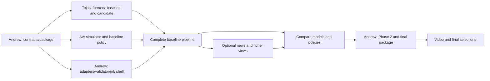

# Implementation plan and execution order

Assignments authorized by Jaseer on November 6, 2026. This is the canonical code
plan; [contracts](contracts.md) define module boundaries and
[requirements](databricks-requirements.md) define product acceptance. Assigned
issues and individual handoffs are in [the agent index](agents/README.md).

## End goal and current state

Deliver a valid 260-row competition CSV whose disruption/price forecasts drive
useful inventory and supplier decisions, with honest historical validation,
reproducible Delta/Spark/MLflow evidence and an approximately 3-minute video.
Select final Kaggle submissions and complete the track/video deadlines.

Done: authenticated CLI/SDK, team access, 10 source plus 2 derived Delta tables,
checksum/key/join checks, serverless setup job, MLflow setup run, and unchanged
validated sample. AV independently reran setup successfully.

Not done: feature/forecast code, simulator/policy, model/policy backtests,
end-to-end training/export job, baseline/candidate comparisons, demo/video and
final selections. A copied organizer sample is not a complete baseline pipeline.

This review corrected the blank ownership/template README, incomplete API and
window contracts, potential gold-table context collisions, historical reuse of
week-208 sample values, ambiguous Phase 2 public-row handling, and Andrew's
missing setup-job edit permission. It also distinguishes verified setup from
future model implementation. The package/API follows the owners' existing
#7/#8 agreement; duplicate planning issues #9/#11 are closed.

## Owners and execution order

| Owner | Work |
| --- | --- |
| Andrew `@andrewkwon0804-web` | Integration lead; shared package/contracts/config/dependencies; Delta adapters; run CLI/job; validator/exporter; MLflow evidence; Phase 2/final package; demo/video script; optional news last |
| Tejas `@tbhojo` | Historical Spark features, origin-safe forecast baselines/candidates, forecasting metrics/calibration/ablations |
| AV `@AV-01` | Simulator and explicit assumptions, naive/diversified order policies, allocation optimization, raw/proxy cost/resilience evaluation |
| Jaseer `@JA-01` | Existing setup/access source, brief environment support and human review/delivery decisions; no longer the integration/export implementer |

Exact paths are in `AGENTS.md`. Andrew sequences the integration queue; only
Jaseer reassigns people. All agents review and correct planning docs by small PR.

Andrew merges scaffold/contracts first, then implements adapters/export against
fixtures. Tejas/AV start immediately against documented interfaces rather than
waiting idle. They merge their own modules and hand them to Andrew for wiring.
Do not duplicate another owner's module. Andrew may keep explicit provisional baseline adapters in his own `halcyon/baselines.py` until owner implementations land; keep their provenance visible.

Each edits a separate workspace namespace under
`/Workspace/Shared/halcyon/{pipeline,forecasting,policy,demo}/`. Git source is
authoritative. Preserve the existing `Workspace Setup` notebook/job; Andrew
creates a separate training pipeline and experiment.

## Milestones and acceptance gates

### M1 — connected baseline, first working block tonight

Andrew: package/contracts/config validation, pinned-release loaders, request and
window construction, exporter/validator, outer job and MLflow packaging.
Tejas: historical disruption-rate and carry-forward-price baselines.
AV: origin-safe naive policy plus functional simulator and assumptions.

Pass when a real run consumes Delta data, predicts both windows, plans orders
with independent inventory, and exports all 260 valid rows with exact bytes,
checksum and manifest in MLflow/Volume. No LLM or custom UI is required.

### M2 — improvement evidence, Saturday morning target

Develop on historical origins 130/156 with 26-week forecasts and independent
13-week evaluation windows. Reserve origin 182 (183–208) as the final holdout.
Report horizon 1–13 separately for the Phase 2 task. Select settings on the
development folds; evaluate final holdout once and report regressions honestly.

Tejas starts with pooled tabular models in existing scikit-learn; CatBoost is
optional after pin/runtime agreement with Andrew. AV compares inventory-cover
and diversified policies before a larger optimizer. Andrew logs forecast-only,
policy-only and combined changes so their contribution is clear.

Pass with raw Brier/MAPE, purchase/holding/shortage/salvage costs, overall and
shock/recovery fill, and diversification by fold/horizon/material where useful.
No random row splits, week-208 baseline leakage, or invented official score
when hindsight/normalizer/simulator parity is missing.

### M3 — Phase 2 refresh, Saturday November 7 after noon Central

Andrew obtains the released competition files, verifies history through 221,
and invokes the existing bootstrap for a new immutable snapshot. He has
project-scoped setup-job management; coordinate source edits to
`tools/databricks/` with Jaseer. Pin the new table versions, retrain through 221,
forecast private 222–234 with fresh stock/transit, and join archived valid public
rows. Preserve lineage and older candidates; do not hand-edit feature code.

Pass when both Phase 1 26-week and Phase 2 private 13-week paths work, every
export keeps all 260 IDs, and all archived/new blocks have run/cutoff provenance.
Known public outcomes are not a new validation set.

### M4 — freeze and deliver

Andrew prepares up to two validated candidates with run IDs, checksums,
comparison notes and known-good fallback. Prepare a notebook demo and offline
results showing a source signal → forecast → order → evaluation, with actual
Delta/Spark/MLflow evidence and one limitation. Produce the video script.

Humans confirm Kaggle team merge, opt-in, final candidate selection and video
upload. Andrew prepares artifacts/checklist, not fictional upload success or
unselected use of limited submission attempts.

| Deadline (America/Chicago) | Action |
| --- | --- |
| Sat Nov 7, noon | Andrew refreshes Phase 2; Tejas/AV inspect diagnostics |
| Sat Nov 7, 6 PM | Jaseer/designated human confirms Databricks opt-in submitted |
| Sat evening target | Andrew freezes candidates and demo/script; team records |
| Sun Nov 8, noon | Select up to 2 final submissions and upload ~3-minute video |

Five submissions/team/day; merge the Kaggle team before the first. Per the
cheat sheet, private leaderboard placement contributes 80% and video 20%.

## Priorities, operation and handoffs

P0: complete baseline, cutoff-safe candidate/validation, functioning simulator
and policy, Delta/Spark/MLflow job, final CSV/video package. P1: cached news and
richer explanations/charts after M1. P2: chatbot/custom frontend, hosted model
endpoints, MCP, registry and distributed training; none may block delivery.

Andrew's target entry point is `python -m halcyon.pipeline --config <json>` with
an equivalent saved serverless notebook job. It does not exist yet. It selects
release/versions, generates windows/requests, calls owned modules, evaluates
only where truth exists, logs gold/MLflow artifacts and validates exported bytes.

Every read filters release and pins versions; every output is run-scoped.
Never pass future truth to a model/policy or carry public inventory to private.
Failure falls back explicitly to a validated baseline with a recorded reason.
Unresolved simulator rules become AV's named assumptions/sensitivity, not a
block on the baseline. An unavailable LLM means deterministic/no-news features.

Post issue claim, first mergeable increment, and final handoff with PR/commit,
entry point/config, frame schema, checks/metrics, limitations and next owner.
All agents must review these plans now and post findings/corrections on the
board. Coordinate shared API changes and cross-owner source handoffs.
