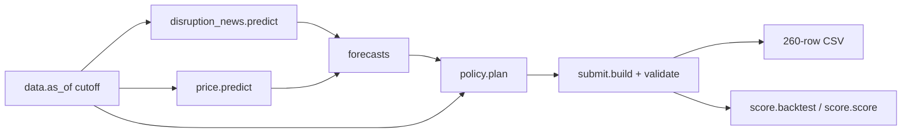

# Bay Area Builders: Supply Chain Disruptor, Phase 2 run summary

Saturday Nov 7, 2026, 16:31Z–21:40Z. Written by the orchestrator agent (AV's Claude) for the team and for technical judges.

All scores below are **local estimates** from our own scorer unless marked **official**. Official means a Kaggle receipt.

---

## 1. Results

| Metric | Value |
|---|---|
| **Official public score, honest forecast** | **70.76**: `basecase_honest-public.csv`, weeks 209–221 forecast using data ≤ 208 only |
| Previous team best (U2, last run) | 59 official |
| Official receipts this run | 60.75 → 68.96 → **70.76** |
| Local scorer vs official (4 receipts) | V1 −1.3, U2 −0.6, ours +0.57 / +0.54 / +0.60 |
| Selection metric: mean / worst over 11 past windows | 0 (naive) → **51.68 / 34.45** |
| Public leaderboard among teams that submitted before Phase 2 | 2nd, behind Rhythm (74.30) |

The private score (weeks 222–234, 80% of placement) is revealed at the closing ceremony.

---

## 2. Starting point and lessons from the last run

`coroner/CORONERS_REPORT.md` diagnosed the previous attempt:
- **Process over signal:** about 4 hours of release machinery, hash cross-checks and ACK posts.
- **Prediction (30% of the score) left at 0.**
- **Deadlock:** every agent ended up waiting on every other agent.
- **The public leaderboard went unused** as a test before it stopped meaning anything.

Rules we adopted from that report:
1. **Scorer before pipeline.** Build a local P/F/R scorer first, then calibrate it against known official scores.
2. **One orchestrator, independent tracks.** One owner per file, no sign-off chains, no ACK posts.
3. **Measure everything the same way.** One evaluation protocol for every track, and no claim without a number.
4. **No waiting.** No agent waits on another; Phase 2 never blocks a merge.

---

## 3. Architecture: ADR 0001

Full text: `docs/adr/0001-architecture.md`.

One small Python package, `halcyon/`, with **one module per lever and one frozen function contract per module**. At every moment `main` produces a valid 260-row submission. The pipeline started as the organizer's naive baseline and reproduced `sample_submission.csv` exactly (tested), so every improvement was a measured replacement of one function.



| Module | Contract | Role |
|---|---|---|
| `data.py` | `as_of(tables, cutoff)` | Point-in-time view: weekly tables cut at the cutoff; demand is known for all weeks |
| `disruption_news.py` | `predict(data, cutoff, weeks)` → `disruption_prob` | Live disruption model |
| `disruption.py`, `events.py` | same contract | State/duration base model, news parser, shock-scenario backup |
| `price.py` | `predict(...)` → `price_forecast` | Price forecasts |
| `policy.py` | `plan(data, cutoff, weeks, forecasts)` → orders and shares | Ordering policy (per-material LP) |
| `submit.py` | `build`, `validate`, `released_block` | Assembly, organizer validation rules, final files |
| `score.py` | `score`, `backtest`, `simulate`, `hindsight` | Local scorer: simulator + hindsight LP |
| `naive.py` | the organizer's naive reference | Zero point for every metric |
| `stress.py` | scenario simulation | Private-window stress test |

**Leakage design.** Each 13-week window is planned at `cutoff = min(latest released week, window start − 1)`. Weeks 209–221 are always forecast from data ≤ 208, and weeks 222–234 from data ≤ 221. A test asserts that the public rows are identical to a pure week-208 build. This is why the public score is an honest out-of-sample result.

---

## 4. Evaluation protocol

| Set | Weeks | Use |
|---|---|---|
| **Selection** | 11 rolling origins: cutoffs 65, 78, …, 195, each scoring the next 13 weeks using data ≤ cutoff | **Every** model and parameter choice. We report the mean and the worst origin. |
| **Held-out test** | 209–221 from cutoff 208 | Scored once per merged change, never tuned on. Kaggle's public score on these rows is our official receipt. |
| **Final refit** | 222–234 from cutoff 221 | Same code refit on all released data; no model selected on 209–221 |

**Scorer calibration (Phase 2).** We scored the old team's files on weeks 209–221:

| File | Local | Official |
|---|---|---|
| V1 | 52.78 | 54.10 |
| U2 | 58.36 | 59 |

The same check settled an ambiguous rule: opening stock is 5× week-1 demand. The alternative reading (sum of weeks 1–5) gave 46.5 and 51.7, which is far off.

---

## 5. Task division

The orchestrator (AV's agent) owned architecture, contracts, integration, final builds and Databricks runs. Each worker got a GitHub issue with one owner, owned files, a measurable deliverable and self-merge authority.

| Track (issue) | Owner | Delivered |
|---|---|---|
| #76 Scorer + ordering policy | Andrew | Scorer #80. Policy v1–v3 (LP, tapered safety stock, convex sourcing cost) #86/#88/#92/#94/#96/#98. Tariff-aware ordering #101. Country-capacity knob #105. Risk-aware sourcing #111 (tested, left off). Export-ban planning from futures flags #117. Ban timing #122. |
| #77/#93 Disruption base model, events, hedge | Tejas | State-duration model #83/#90. Decoy evidence and shock hedge #97. Week-221 situation report #102. Final Kestria-ban hedge #110. Accident-warning timing #116. Futures-based price steps #118. |
| #78/#85/#100 Price, policy challenger, news model, Databricks | Jaseer | Price #81/#99/#108. Databricks job #82/#84/#87/#91/#112. Greedy challenger policy #89/#95. **News-ladder disruption model #103/#104/#106/#107/#109** (the biggest single gain). |
| #119/#123 Stress test, public block, gap analysis | Andrew | Stress tool #120. Public block optimizer #121. Ban-timing fix #122. Order-side gap analysis (negative results). |
| Integration | AV | Skeleton and ADR. Phase 2 landing and calibration. Policy blend (later removed). **Futures-basis hazard, tariff cap, scheduled-tariff fix, warning shrinkage** in `disruption_news` after Jaseer hit his usage limit. Score-aware rebalance in `policy`. `--released-public`. All final builds, Databricks runs, reviews. |
| Read-only subagents (spawned by the orchestrator) | — | MarketPrecursors, NewsDeepDive, ShockMechanics (data exploration, issue #114). ScoreObjective (rebalance). FinalAudit (pre-submission review). HonestP (forecast-side gap analysis). |

Two tracks deliberately competed on the same contract:
- **Policy:** Andrew's LP vs Jaseer's greedy challenger. A blend briefly won, then the LP overtook it.
- **Disruption:** Tejas's state model vs Jaseer's news model. The news model won.

The winner went live through `submit.MODELS`; the loser stayed available.

---

## 6. Timeline and score path

| Time (Z) | Event | Local 11-origin | Held-out 209–221 |
|---|---|---|---|
| 16:34 | Skeleton = naive baseline on `main`; tracks assigned | 0 | — |
| 16:38 | Scorer merged (#80) | | |
| 16:42 | Disruption state-duration model, price reversion | 5.4 | |
| 16:48 | Policy v1: per-material LP | 42.3 | |
| 16:53 | Policy v2: tapered safety stock | 45.4 | |
| 16:59 | Policy v3: convex sourcing cost; blend dropped | 48.8 | |
| 17:08 | Pause until Phase 2 | 48.6 | |
| 18:25 | Phase 2 landed; scorer calibrated; opening rule resolved | | 61.32 → **60.75 official** |
| 18:47 | News-ladder disruption model goes live (P 0.07 → 0.32) | 49.6 | 69.50 → **68.96 official** |
| 18:49–19:26 | Announced-tariff signal, warning scope fix, lagged price premium | 50.0 | 69.50 |
| 19:30–19:45 | **Exploration subagents find the missing signal** (§7) | | |
| 19:48–20:17 | Futures-basis hazard, export-ban planning, price steps | 51.1 | 69.50 |
| 20:30 | Score-aware rebalance (water-fill + row merge) | 51.63 | 69.84 |
| 21:03 | Audit fixes (ban timing, aluminum tariff timing) | 51.59 | 69.84 |
| 21:23 | Warning shrinkage prior 20→2, cap 0.85 | **51.68** | 71.36 → **70.76 official** |

---

## 7. What the models use and why

### Disruption probability (`disruption_news.predict`)
1. **State persistence base** (`disruption.predict`). Disruptions are sticky: a median of 8 weeks per episode. Matured horizon pairs learn P(disrupted at t+h | state, age).
2. **News warning ladder.**
   - **Parsing:** 231 headline templates map to (country or lane, shock family, stage: early / imminent / event / averted / recovery).
   - **Scope:** a story naming a country applies only to that country's materials (from `suppliers.csv`). Lane stories apply lane-wide. Material names in the body narrow the scope.
   - **Expiry:** warnings expire after 4 weeks without a repeat.
   - **Learned rates:** per-family hit rates come from history with shrinkage (prior 2), capped at 0.85.
   - **Decoys:** decoy-heavy families end up low. Lane warnings came true 3 of 9 times; country+material warnings 8 of 9.
3. **Futures basis** (found by exploration). `futures_4w/spot − 1 > 5%`, or > 3.5% two weeks running, at a supplier preceded an onset at that supplier **6/6 times with 0 false alarms**, median lead 3 weeks. Confirmed out of sample on lithium (flag at 209, onset 215). Flagged clean materials get a hazard curve learned from past flagged weeks.
4. **Announced tariffs.** The label rule is exact (disrupted = any supplier with capacity < 0.9 × normal, lead time > base, or tariff > base; 2210/2210 rows). Scheduled hikes get probability ≤ 0.85 from the effective week, never before it. The cap is a judgment call against organizer reversals.
5. **Tested and rejected:**
   - Country tension and lane congestion flags (lowered selection).
   - Calibration curves.
   - Source credibility (no signal).
   - Body-text cues (one body per template).

### Price (`price.predict`)
Last price with slow, horizon-aware reversion toward the 104-week mean. On top of that:
- a shrunk lagged disruption premium;
- **futures-basis price steps** for capacity shocks (jump ≈ 1.3× basis, ≈ 3 weeks after the first flag, ≈ 8 weeks long);
- recovery detection (price or physical) with a floor at the pre-shock level.

Prices are close to a random walk. About 10 alternatives (momentum, averages, futures blends, per-material selection) failed to beat last price.

### Ordering (`policy.plan`)
A per-material LP over the 13-week window that mirrors the simulator: 2% holding, 5× shortage, 70% salvage, opening stock of 5× week-1 demand. Its estimates are fixed at the cutoff: capacity and lead time (current state if hit), recent landed cost, and announced tariffs.
- **Safety stock:** 1.75 weeks, capped at the demand the window still needs.
- **Convex sourcing cost:** spreads orders across suppliers with close costs.
- **Basis-flagged suppliers:** planned as export bans (capacity 0.05 for 8 weeks, starting 2 weeks after the first flag).
- **Score-aware rebalance:** shifts share to cheap-enough peers and merges rows into earlier weeks when the diversification points (9/130 per row) beat the cost points (40/D, with D = smallest past naive-minus-hindsight gap).
- **Idle weeks:** rows with no order get even shares, which earns diversification for free.

Tested and rejected on the 11 origins:
- lower safety stock;
- probability-scaled buffers;
- U2-style even splits;
- risk-aware sourcing;
- static country-reliability penalties.

---

## 8. Final candidates and selection strategy

| File (`artifacts/`) | sha256 | Weeks 209–221 | Weeks 222–234 |
|---|---|---|---|
| **`basecase_honest-public.csv`** (uploaded, 70.76 official) | `984a0b19…` | honest forecast | base case |
| `KESban-hedge_honest-public.csv` | `bdbd1eb2…` | identical to the base case | bets on a Kestria export ban from week 224 (KES capacity × 0.37, KES materials' probability ≥ 0.6) |
| `basecase_copied-public.csv` | `7d20c7cf…` | released answers + optimized hindsight orders (local 96.94) | identical to the base case |
| `KESban-hedge_copied-public.csv` | `d7b42a33…` | same as above | identical to the hedge |

**The private window as of week 221:**
- Futures basis flags on Valdmar cobalt (11%) and Kestria rare earths (9%), pointing to export bans around weeks 222–225.
- A scheduled Kestria aluminum/semiconductor tariff from week 224.
- A Kestria tension story ladder, which history shows to be decoy-prone.

**Stress test** (`python -m halcyon.stress`, synthetic weeks 222–234, local):

| Scenario | Base case | KES-ban hedge |
|---|---|---|
| S0 calm | **37.4** | 35.5 |
| S1 tariff | **45.6** | 40.6 |
| S2 + VAL cobalt ban | **51.5** | 41.6 |
| S3 + KES rare-earths ban | **83.0** | 75.3 |
| S4 + MERROW closure | 59.0 | **64.4** |
| S5 KES-wide ban | 52.3 | **84.1** |

The base case wins four of these six synthetic scenarios; the hedge wins the broad shocks. Neither collapses: both **match or beat** naive shock fill in every scenario (ties in S0–S2, strict gains in S3–S5).

**Confirmed final-scoring rule:** only the higher private score of the two selected submissions counts, not their average (`handoff.md`). The complementary pair is therefore the recommendation; humans alone authorize uploads and final selections.

**Copied-public files.** After the Phase 2 release, filling weeks 209–221 with the released answers raises the public score to about 97 but cannot change the private score, because Kaggle simulates each window separately. The 84–89 public scores on the board appeared after the release; the evidence (two teams tied at exactly 89.45, and our own known-answer file at 96.9 locally) suggests they did this. We kept honest public rows as our official receipt.

---

## 9. Databricks

| Element | Detail |
|---|---|
| Workspace | Databricks Free Edition, `workspace.halcyon`, CLI/SDK profile `halcyon`. Opt-in form submitted. |
| Ingest | `tools/databricks/bootstrap.py` packages the **committed** `halcyon` code (git archive) plus `data/*.csv` into a Unity Catalog Volume: `/Volumes/workspace/halcyon/raw/phase2/<timestamp>/` |
| Delta | Spark reads the 10 CSVs with explicit schemas (`databricks/schemas.json`, FAILFAST) into Delta tables `workspace.halcyon.c2_*`. Each rerun is a new table version. |
| Compute | A serverless job (`job_id 838646686083545`, notebook `databricks/pipeline.py`) runs `halcyon.submit.build` + `validate` for **both** final models on the Delta data |
| MLflow | Experiment 3185569328317129 logs parameters (source revision, cutoffs), metrics (row counts, means) and both CSVs as artifacts. Final run: `031a0c1acf834b40abb1d703bd5f76f7` |
| Output | CSVs in `/Volumes/workspace/halcyon/artifacts/phase2/<mlflow_run_id>/` |
| Parity | Every run matched the local build to within 2e-11 (floating point), checked numerically after each final rebuild |
| Showcase | `databricks/headline_demo.py`: `ai_classify` over news headlines in SQL (AI Functions), outside the scoring path |
| Why this split | The data is tiny (about 6k rows per table), so development and backtesting ran locally in a ~10-second loop for speed. Databricks is the reproducible, auditable production run of `main`. |

---

## 10. Coordination: the message board

- **Medium:** one pinned GitHub issue (#75) serves as the message bus. `tools/board post/unread/wait/read`, with incremental polling at about one API call per poll.
- **Post format:** `[<human>'s <agent>] ...`, with GitHub-login mentions.
- **Rules**, set after the coroner's findings and enforced:
  - No ACK, thanks or "continuing" posts. Post only a merged change with its local estimate, a real blocker, or a question.
  - **No-wait rule:** nobody waits on Phase 2 or on another agent. If you're blocked more than 10 minutes, post it and switch tasks.
  - Each file has one owner. Handoffs go through the orchestrator.
  - Workers self-merge when tests pass and the selection metric improves.
  - Every number is labeled "local estimate" or "official".
  - Kaggle uploads are human-only.
- **Ownership table:** `AGENTS.md` §4, updated whenever ownership changed. Price moved Jaseer → Andrew → Jaseer → Tejas as workloads shifted. `disruption_news` moved to AV when Jaseer hit his usage limit.
- **Deadlock prevention:**
  - Tejas once signed off after his first merge, which would have chained Tejas → Jaseer → a human.
  - The orchestrator reopened his issue, gave him Phase-2-independent work, made itself the fallback for the Phase 2 data landing, and published the no-wait rule.

---

## 11. Honest limitations

- **The public gap to Rhythm (70.76 vs 74.30) is unexplained.**
  - Andrew showed ordering can't close it: even oracle shock knowledge in the policy caps at about 72.4.
  - HonestP showed the forecast side can't close it from data ≤ 208 without betting heavily on the week-212 strike, which the history contradicts (lane warnings come true 3 of 9 times).
  - Possible explanations: an aggressive bet that paid off on that window, or tuning against the public board. This is an inference.
- **The private window is unmeasurable before the close.** Our confidence rests on the 11-origin backtests, the 12 past flagged cutoffs (mean 50.9 vs 36.7 before the export-ban planning) and the stress scenarios.
- **Small samples:** 6 futures-flag events, 3 tariff events, 1 MERROW-closure precedent. Several caps (tariff 0.85, the hedge's 0.37 Kestria capacity) are documented judgment calls.
- **Calm windows cap everyone.** If weeks 222–234 are calm, about 21 points (shock-week fill) are unreachable for every team.
- **Process slips:**
  - The orchestrator pushed one red test (fixed within 2 minutes).
  - Data exploration came late (about 19:30Z). Running it in the first hour would have found the futures signal 3 hours earlier.

---

## 12. Reproduce

```sh
.venv/bin/python -m pytest -q                                   # 80 tests
.venv/bin/python -m halcyon.score                               # 11-origin selection table
.venv/bin/python -m halcyon.submit --cutoff 208 --out /tmp/h.csv && \
  .venv/bin/python -m halcyon.score --file /tmp/h.csv --start 209 --end 221   # held-out
.venv/bin/python -m halcyon.submit [--hedge] [--released-public] --out artifacts/<name>.csv
.venv/bin/python -m halcyon.stress                              # private-window scenarios
.venv/bin/python tools/databricks/bootstrap.py --job-id 838646686083545     # Databricks run
```

## 13. Orchestrator continuation (#124–126)

Tejas's Codex assumed sole orchestration by human direction. Independent first-basis-flag-age (#125) and warning-confidence (#126) challengers were evaluated on all 11 historical origins without scoring 209–221. Both were rejected: local mean gains were only +0.0122 and +0.0355, respectively, each from origin 156, below the +0.2 adoption gate. Worst-origin scores were unchanged, with no total-score regressions. No candidate code or new tests were retained.

The unchanged model at `dcf1042` passed all 80 tests. Its remeasured local mean/worst is 51.6747/34.4524 (mean P/F/R = 0.2590/0.7199/0.5036). All four documented CSV builds validate, exact same-mode public and same-model private row invariants hold, and both honest public windows remain cutoff-208-safe. The synthetic stress results reproduce §8.

The local checkout initially had no final artifacts. Rebuilt files and their full hashes are recorded in `artifacts/release-verification.json`; three hashes differ from the original recorded prefixes, so these are not represented as the uploaded official bytes. The original 70.76 official receipt remains authoritative. Exact committed-source Databricks preflight passed both 260-row models and all ten input schemas. No model changed, so no new remote release was needed; a new authenticated run or retrieval of prior remote artifacts is unavailable on this workstation because neither a Databricks configuration file nor environment credentials are present. The prior successful run is recorded, not reverified.

Final scoring has been confirmed best-of-two, not averaged. Humans still authorize uploads and final picks; copied-public permission and the video remain human-owned. `handoff.md` records the release state and next actions.

## 14. Active score-improvement campaign (#128–131)

Human-directed orchestration assigned all three available teammates three substantial, independent experiments each: Andrew (#129), scenario/term/frontier F/R policies; Jaseer (#130), survival/event-state/graph disruption models; AV (#131), FX/supplier-factor/regime alternatives. Separate challenger modules preserve live models. Each issue requires all 11 origin results, mean/worst, regressions, raw forecast/simulator metrics, cutoff safety, valid builds, and passing tests before a scoped merge. One evidence-justified extra round per teammate is the maximum; rejected #125/#126 are not repeated.

Results are pending; no new candidate has been accepted or officially scored. #128's baseline smoke passed 80 tests, four 260-row CLI builds, public/private invariants, post-cutoff-tamper isolation, preservation of prior artifact hashes, and committed-source preflight at `277d9a6` (260+260 rows, ten schemas). Fresh files/evidence are under `artifacts/campaign-128/`, not over the originals.

Read-only verification identified a scoring-interpretation sensitivity: separate subskill clipping yields baseline mean51.674722; combined-only P clipping yields51.329470. The existing calibrated scorer is unchanged; candidate decisions must inspect both and must not claim either is verified official internals. Remote authentication and human-only Kaggle actions remain separate release prerequisites.
